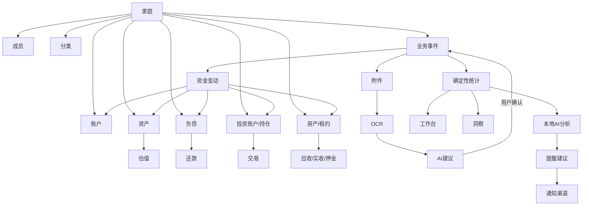
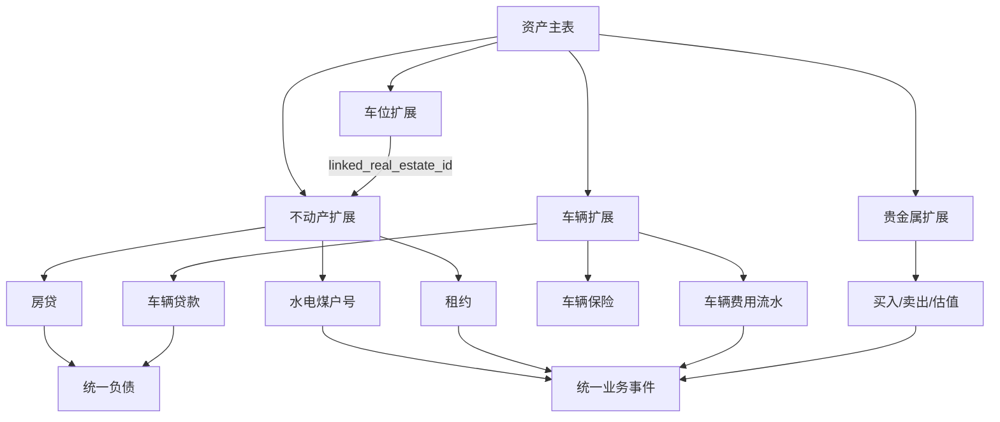
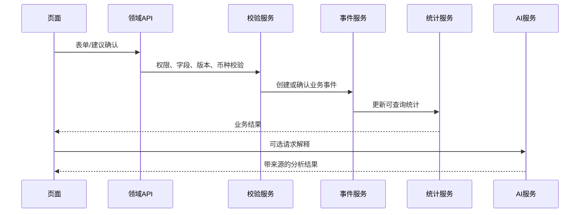

# 02 · 页面树与全量关联关系

## 1. 完整页面树

```text
系统入口
  ├─ 安装检测
  ├─ 首次启动引导
  │   ├─ 数据库连接
  │   ├─ 管理员账号
  │   ├─ 家庭基础信息
  │   ├─ 财务基础口径
  │   ├─ 本地AI连接
  │   ├─ 百度OCR配置
  │   ├─ 通知渠道配置
  │   └─ 完成与登录
  ├─ 登录
  ├─ 忘记/重置密码
  └─ 首次登录欢迎
平台
  ├─ 工作台
  ├─ 家庭台账
  │   ├─ 台账总览
  │   ├─ 资产
  │   │   ├─ 资产列表
  │   │   ├─ 新增/编辑资产
  │   │   ├─ 资产详情
  │   │   ├─ 不动产详情
  │   │   ├─ 车位详情
  │   │   ├─ 车辆详情
  │   │   ├─ 贵金属详情
  │   │   └─ 估值历史
  │   ├─ 账户与流水
  │   │   ├─ 账户列表
  │   │   ├─ 新增/编辑账户
  │   │   ├─ 流水列表
  │   │   ├─ 新增收入/支出
  │   │   ├─ 内部转账
  │   │   └─ 对账
  │   ├─ 负债与信用卡
  │   │   ├─ 负债列表
  │   │   ├─ 负债详情
  │   │   ├─ 还款登记
  │   │   ├─ 信用卡账单
  │   │   └─ 信用卡还款
  │   ├─ 投资
  │   │   ├─ 投资账户
  │   │   ├─ 持仓详情
  │   │   ├─ 交易登记
  │   │   └─ 估值与收益
  │   ├─ 房产租赁
  │   │   ├─ 房产列表
  │   │   ├─ 租约列表
  │   │   ├─ 租约详情
  │   │   ├─ 租金应收/实收
  │   │   └─ 押金
  │   ├─ 智能录入
  │   │   ├─ 上传材料
  │   │   ├─ OCR结果
  │   │   ├─ AI建议审核
  │   │   └─ 已确认记录
  │   └─ 提醒
  ├─ 洞察
  │   ├─ 综合洞察
  │   ├─ 资产分析
  │   ├─ 收入分析
  │   ├─ 消费分析
  │   ├─ 负债分析
  │   ├─ 投资分析
  │   ├─ 租赁分析
  │   └─ 数据质量
  └─ 设置
      ├─ 家庭与成员
      ├─ 分类管理
      ├─ 财务口径
      ├─ 提醒通知
      ├─ 百度OCR
      ├─ 本地AI
      ├─ 隐私与安全
      ├─ 数据备份与恢复
      └─ 系统状态与审计
```

## 2. 统一领域关系



资产类型的房产主对象统一使用 `real_estates`；房产租赁页面中的“房产”直接引用该对象，不再另建一套 `properties` 主数据。资产类型扩展关系如下：



## 3. 页面与数据关联

| 页面 | 读取 | 写入 | AI上下文 |
|---|---|---|---|
| 工作台 | 统计快照、提醒、最近事件 | 无或跳转草稿 | 家庭综合财务 |
| 台账总览 | 全部已确认统计 | 无 | 当前家庭摘要 |
| 资产 | 资产、估值、购置/处置事件 | 资产、估值草稿 | 当前资产与净资产占比 |
| 账户流水 | 账户、事件、资金变动、分类 | 事件/转账/对账 | 当前账户和期间流水 |
| 负债 | 负债、还款、账单 | 负债/还款草稿 | 偿付压力和到期 |
| 投资 | 投资账户、交易、持仓、估值 | 交易/估值草稿 | 持仓、成本和收益 |
| 租赁 | 房产、租约、应收、实收、押金 | 租约/收租/押金草稿 | 收租率和逾期 |
| 智能录入 | 附件、OCR、建议 | 草稿、建议反馈 | 文件内容和历史模式 |
| 提醒 | 到期规则、提醒、发送记录 | 提醒草稿/确认 | 可提醒事项 |
| 洞察 | 只读统计视图 | AI洞察快照 | 跨模块分析 |
| 设置 | 配置和状态 | 配置、成员、分类、审计 | 接入状态，不直接分析业务 |

## 4. 统一写入链路



## 5. 全局返回关系

所有列表行、图表点、AI结论、提醒卡和统计卡都必须提供“查看来源”或“查看明细”路径，最终定位到家庭台账内的实体详情或事件详情。
