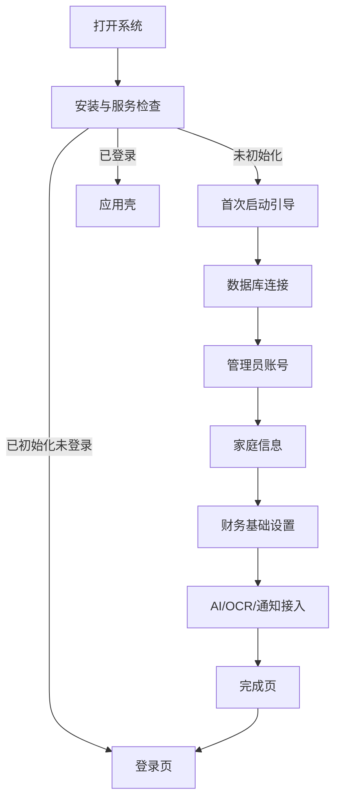

# 04 · 登录页与首次启动引导

## 1. 启动判断流程

## 2. 安装检测页 `/setup/check`

目标：告诉使用者当前系统是否具备初始化条件。

页面：品牌区、系统版本、数据库服务状态、文件权限、后端健康状态、初始化按钮。状态分为检测中、通过、警告、失败。失败项必须显示修复建议和重新检测按钮；此页不需要登录。

## 3. 首次启动引导 `/setup`

使用顶部步骤条和右侧说明区，步骤可回退但不能跳过数据库和管理员步骤。每一步保存草稿，浏览器刷新后可恢复，不保存密码明文。

### 步骤一：数据库连接

字段：数据库类型固定MySQL、主机、端口、数据库名、用户名、密码、SSL开关、连接超时。按钮：测试连接、保存并下一步。测试成功显示延迟、MySQL版本和可创建表权限；失败显示字段级原因。成功后系统创建或验证迁移表，但不要导入旧项目表结构。

### 步骤二：创建管理员

字段：管理员名称、登录账号、密码、确认密码、恢复邮箱或恢复提示。密码实时显示强度、长度、复杂度和常见密码提醒。提交前校验唯一性；创建成功后显示不可逆提醒和账号摘要。

### 步骤三：家庭基础信息

字段：家庭名称、默认时区（默认 Asia/Shanghai）、基础币种（默认 CNY）、家庭描述、是否启用多成员。创建后生成默认家庭、系统分类和基础提醒规则。

### 步骤四：财务口径

字段：是否显示资产购置独立于消费、默认统计周期、净资产是否包含指定资产类型、是否启用投资估值、账单日/还款日显示方式。每个选项有解释文字和恢复默认按钮。

### 步骤五：接入配置

分三张卡片：

- 本地AI：服务地址、协议、模型名、连接测试。默认可跳过，但跳过后可在设置中配置。
- 百度OCR：API Key、Secret Key、测试识别。凭证掩码保存。
- 第三方AI API：提供商、Base URL、API Key、模型、外发策略和连接测试。默认关闭，可跳过，不能在未确认外发范围前启用。
- PushPlus：Token、通知开关、测试发送。默认关闭。

每张卡独立保存，某项失败不阻塞其他项；显示“已连接/未配置/测试失败”。

### 步骤六：完成页

显示管理员、家庭、基础币种、AI/OCR/通知状态摘要；提供进入登录页、查看设置和查看使用指南。首次登录后再显示欢迎引导，不重复进入初始化。

## 4. 登录页 `/login`

布局：左侧品牌和动态背景，右侧登录卡片。字段：账号、密码、记住设备、登录按钮。辅助：忘记密码、查看系统状态、切换语言（若实现多语言）。

状态：初始、输入中、提交中、登录成功、账号不存在、密码错误、账号锁定、服务不可用、初始化未完成。密码错误不提示具体是账号不存在还是密码错误；连续失败按配置触发短暂锁定。

交互：回车提交；提交期间按钮显示进度且不可重复点击；成功后卡片缩小淡出，应用壳从右侧淡入；失败保留账号，清空密码并聚焦密码框。

## 5. 忘记/重置密码

本地部署默认提供管理员恢复流程：验证管理员恢复方式、设置新密码、失效旧会话、写入审计。若未配置邮箱，显示管理员在本机执行恢复流程的提示，不伪造外部找回能力。

## 6. 首次登录欢迎

进入工作台前显示一次性欢迎层：三步介绍“录入数据—查看台账—让AI分析”；提供立即新增账户、上传第一张账单、打开AI助手三个入口；可以关闭，关闭后不再自动出现。

## 7. 安全要求

登录和初始化必须使用HTTPS或本地安全传输；密码不得以明文或可逆形式保存，服务端使用强哈希；会话过期跳转登录；记住设备使用可撤销刷新令牌；初始化接口仅在系统未初始化时开放；初始化完成后关闭公开初始化接口。
