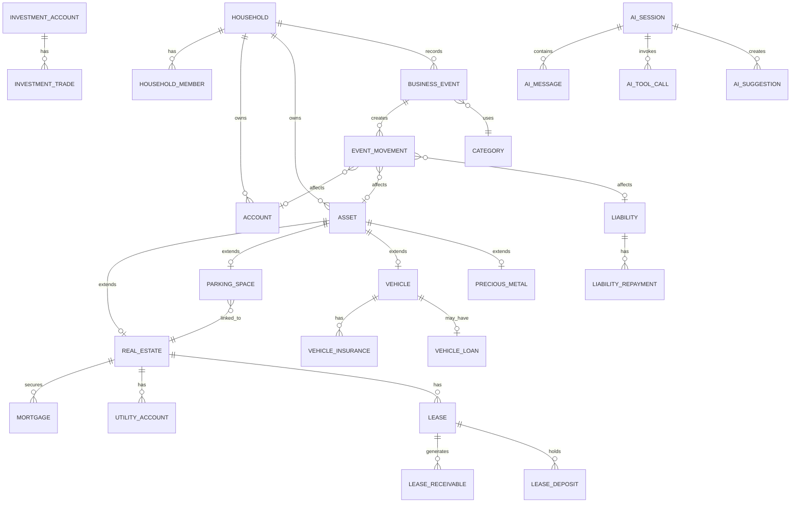

# 10 · 数据库、API与安全契约

## 1. 核心表

身份：`system_config`、`users`、`households`、`household_members`、`roles`、`role_permissions`、`member_scopes`、`user_sessions`、`audit_logs`、`audit_log_changes`。

配置：`household_settings`、`categories`、`notification_channels`、`ocr_configs`、`local_ai_configs`、`third_party_ai_providers`、`privacy_policies`、`user_preferences`、`exchange_rates`、`schema_versions`、`deployment_configs`、`maintenance_windows`、`secret_key_versions`、`ai_evaluation_cases`。

业务：`accounts`、`assets`、`asset_valuations`、`real_estates`、`mortgages`、`utility_accounts`、`parking_spaces`、`vehicles`、`vehicle_loans`、`vehicle_insurances`、`precious_metals`、`business_events`、`event_movements`、`liabilities`、`liability_repayments`、`credit_cards`、`credit_card_bills`、`investment_accounts`、`investment_trades`、`investment_valuations`、`leases`、`lease_receivables`、`lease_deposits`、`reminders`、`notification_deliveries`、`attachments`、`ocr_call_logs`、`data_quality_issues`、`backup_records`、`restore_records`、`import_batches`、`import_records`。

AI：`ai_sessions`、`ai_messages`、`ai_tool_calls`、`ai_insights`、`ai_suggestions`、`ai_feedbacks`、`ai_evaluation_runs`。

不创建盘点、位置、导出、任务队列和后台Worker表。

## 2. 关键关系

## 3. 字段硬约束

所有业务表有 `id`、`household_id`、`created_at`、`updated_at`、`created_by`、`updated_by`、`deleted_at`。金额和汇率 `DECIMAL(20,4)`，数量 `DECIMAL(20,8)`，币种使用ISO代码，时间存UTC并按家庭时区展示。API金额、数量使用字符串。

## 4. API分组

`/api/auth`、`/api/setup`、`/api/dashboard`、`/api/ledger/assets`、`/api/ledger/assets/real-estates`、`/api/ledger/assets/parking-spaces`、`/api/ledger/assets/vehicles`、`/api/ledger/assets/precious-metals`、`/api/ledger/accounts`、`/api/ledger/events`、`/api/ledger/reconciliation`、`/api/ledger/liabilities`、`/api/ledger/investments`、`/api/ledger/leases`、`/api/ledger/capture`、`/api/ledger/reminders`、`/api/insights`、`/api/ai`、`/api/settings`、`/api/audit`。

## 5. 必要接口

认证：初始化状态、登录、刷新会话、退出、修改密码、重置密码、查看/撤销会话。

初始化：测试数据库、提交数据库、创建管理员、创建家庭、保存财务口径、保存本地AI/OCR/通知/第三方AI提供商、完成初始化。

业务：各实体列表/详情/创建草稿/确认/更正/归档；转账、还款、对账、交易、租金实收、押金操作使用专门接口。

分析：工作台快照、各主题分析、数据质量问题、图表数据、洞察详情、来源明细。

AI：会话、消息、工具调用、建议接受/拒绝、状态测试、反馈、外发预览、提供商测试、模型能力测试；OCR：连接测试、调用记录、失败重试；通知：渠道测试、同步发送、发送记录和失败重试；备份：创建、完整性验证、恢复预览、恢复执行和恢复审计。

## 6. 事务与幂等

确认业务事件、转账、还款、接受AI建议、创建通知记录必须事务化并支持幂等键；源数据版本变化返回409并要求用户刷新。所有列表查询带家庭和权限范围。

## 7. 安全

密码强哈希；Token/Secret加密；日志脱敏；初始化接口完成后关闭；文件白名单和大小限制；AI工具白名单；防止提示词注入；防止越权读取；外部网络调用可审计；第三方AI默认关闭；第三方AI调用前展示外发字段；第三方AI失败不能静默切换；所有用户、权限、会话和配置变更可审计；审计主记录和字段差异记录只允许追加。
