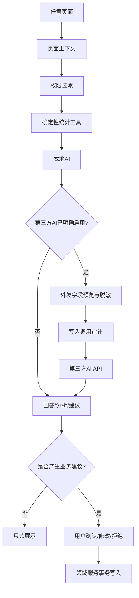

# 14 · V2.1全量审查与补充矩阵

审查日期：2026-10-15

## 1. 审查结论

经逐文件审查，V2.1 已形成“AI贯穿全项目”的完整主线。AI不是单独菜单，而是通过全局助手、工作台摘要、家庭台账上下文、智能录入、洞察报告和设置接入状态覆盖系统。

本次审查补齐了四项原本不够明确的内容：

1. 设置中的用户管理细节，包括用户、角色、数据范围、会话和权限审计。
2. 设置中的第三方AI API独立接入页，不与本地AI混为一谈。
3. 每个页面的AI接入、职责和禁止事项矩阵。
4. 通知发送的真实触发方式，明确不使用后台任务、Worker或任务队列。
5. 资产类型专项字段和关系图，覆盖不动产、房贷、车位、车辆、车贷、车险、贵金属和房屋水电煤户号。

## 2. AI覆盖核对表

| 能力 | 文档位置 | 结论 |
|---|---|---|
| 全局AI入口 | 02、05、09 | 已覆盖 |
| 工作台AI摘要 | 05、09 | 已覆盖 |
| 资产分析 | 06、07、09 | 已覆盖 |
| 消费分析 | 06、07、09 | 已覆盖 |
| 收入分析 | 06、07、09 | 已覆盖 |
| 账户和流水分析 | 06、09 | 已覆盖 |
| 对账差异分析 | 06、09 | 已覆盖 |
| 负债与信用卡分析 | 06、07、09 | 已覆盖 |
| 投资分析 | 06、07、09 | 已覆盖 |
| 房产、租赁、押金分析 | 06、07、09 | 已覆盖 |
| OCR清洗与智能录入 | 04、06、09 | 已覆盖 |
| 分类建议和字段补全 | 06、09 | 已覆盖 |
| 提醒建议 | 06、09 | 已覆盖 |
| 洞察报告 | 07、09 | 已覆盖 |
| 设置状态解释 | 08、09 | 已覆盖 |
| 用户管理辅助 | 08、09 | 已覆盖，且禁止AI自动改权限 |
| 本地AI | 04、08、09、10 | 已覆盖 |
| 第三方AI API | 08、09、10 | 已补齐 |
| 百度OCR | 04、06、08、10 | 已覆盖 |
| PushPlus通知 | 04、06、08、10 | 已覆盖 |
| 不动产专项字段 | 15 | 已补齐 |
| 房贷专项字段 | 15 | 已补齐 |
| 车位与不动产关联 | 15 | 已补齐 |
| 车辆、车贷、车险 | 15 | 已补齐 |
| 贵金属专项字段 | 15 | 已补齐 |
| 房屋水电煤户号 | 15 | 已补齐 |

## 3. 设置模块核对表

设置模块必须实现以下页面：

| 页面 | 必须具备的内容 |
|---|---|
| 设置首页 | 配置完整度、管理员/家庭、AI/OCR/第三方AI/通知状态、分类数量、审计入口 |
| 家庭与成员 | 家庭信息、用户列表、用户详情、角色、数据范围、会话撤销、重置密码、审计 |
| 分类管理 | 分类域、树形关系、启停、排序、AI可推荐、引用保护 |
| 财务口径 | 币种、时区、统计周期、资产购置和投资估值口径 |
| 提醒通知 | PushPlus、渠道开关、提醒类型、测试发送、失败重试、通知记录 |
| 百度OCR | Key/Secret、接口、启停、测试材料、调用状态、错误信息 |
| 本地AI | 协议、地址、模型、超时、上下文、流式、连接状态 |
| 第三方AI API | 提供商、Base URL、Key、模型、能力、优先级、外发预览、审计 |
| 隐私与安全 | 脱敏、数据留存、云端开关、外部调用审计 |
| 系统状态与审计 | 版本、数据库、迁移、存储、各提供商状态和审计查询 |

## 4. AI调用链核对

## 5. 第三方AI与本地AI的区别

| 项目 | 本地AI | 第三方AI API |
|---|---|---|
| 默认状态 | 可配置，优先使用 | 默认关闭 |
| 数据是否出网 | 默认不出网 | 只有显式开启才可出网 |
| 配置位置 | 设置/本地AI | 设置/第三方AI API |
| 调用前提示 | 本地连接状态 | 外发字段预览和确认 |
| 密钥 | 如需则加密保存 | 必须加密保存、掩码显示 |
| 失败策略 | 保留确定性功能 | 不可静默接管本地AI请求 |
| 审计 | 记录模型、工具和结果摘要 | 额外记录提供商、外发范围和响应状态 |

## 6. 通知核对

通知不是后台任务。系统在打开提醒页时实时计算到期状态；用户确认发送后同步调用PushPlus，生成发送记录。失败时保留台账内提醒，允许用户重试。这样既满足通知接入，又不引入用户已经明确不要的后台任务体系。

## 7. 仍然明确禁止

AI不能读取密码、Token明文或无权限家庭数据；不能直接写业务表；不能自动确认OCR结果；不能自动改资产估值、账户余额、负债本金、投资交易、租金实收；不能自动下单、转账、删除；不能静默把本地AI请求转发到第三方AI；不能创建后台任务、导出文件或位置管理。

## 8. 开发验收结论

开发AI完成后必须逐项演示：

1. 首次启动配置数据库和管理员。
2. 设置中新增并测试本地AI。
3. 设置中新增并测试第三方AI，展示外发预览和审计。
4. 设置中管理用户、角色、数据范围和会话。
5. 设置中配置百度OCR并在智能录入中使用。
6. 设置中配置PushPlus并从提醒页面手动发送测试通知。
7. 在资产、流水、负债、投资、租赁和洞察页面分别打开AI并查看来源。
8. 用AI生成一条分类/流水/提醒建议，确认后才写入正式台账。
9. 关闭所有AI后，手工记账、统计和历史查询仍然正常。
10. 验证不动产、车位、车辆、贵金属专项字段、关联关系和AI分析均可使用。
