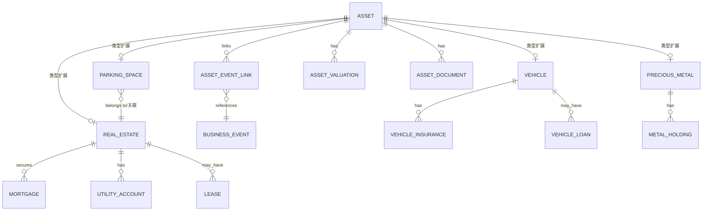
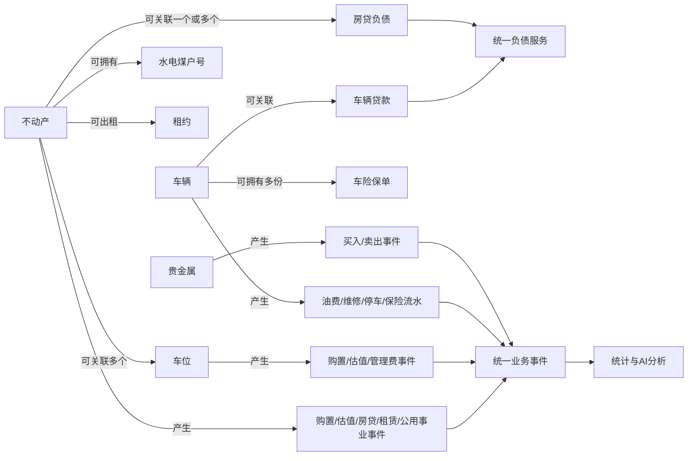

# 15 · 资产类型专项模型与页面细节

## 1. 资产类型总原则

资产不能只用“名称、类型、金额”三个字段。系统采用“资产主表 + 类型扩展表 + 关联关系 + 估值历史 + 业务事件”的结构。资产主表保存所有类型共有字段，类型扩展表保存不动产、车位、车辆、贵金属及其他资产的专属字段。

## 2. 资产通用字段

所有资产共有：资产名称、资产类型、资产子类型、持有人/成员、币种、购置日期、购置成本、当前价值、价值来源、最近估值日期、状态、是否计入净资产、关联账户、关联负债、关联文件、备注、创建人、更新时间。

状态：持有中、出租中、闲置、在贷、已出售、已报废、已归档。出售、报废和归档不能直接删除，必须留下日期、原因和关联事件。

## 3. 不动产 `/ledger/assets/real-estate`

### 3.1 基础资料

字段：房产名称、房产类型（住宅/商铺/办公/车库/其他）、房产证编号、不动产权证号、房屋坐落地址文本、楼栋、单元、楼层、房号、建筑面积、套内面积、土地使用面积、房屋朝向、户型、建成年份、购买日期、交付日期、购买总价、装修金额、税费、中介费、当前估值、估值日期、估值来源、持有人、共有比例。

证件号码属于敏感数据：默认掩码展示，只有授权用户可以查看完整值；附件可以上传房产证、购房合同、契税凭证和评估材料。

### 3.2 房贷字段

是否有房贷；若有：贷款机构、贷款合同编号、贷款初始金额、当前剩余本金、贷款开始日期、贷款年限、贷款到期日、贷款利率类型（固定/浮动/LPR加点/其他）、当前利率、利率调整周期、还款方式（等额本息/等额本金/先息后本/一次性/其他）、还款日、每期应还金额、首期还款日、提前还款规则、关联负债ID、关联还款账户。

房贷必须关联到具体不动产；贷款余额、利息和本金由负债模块管理，不在资产页面重复录入为第二套数据。资产详情显示房贷摘要并跳转负债详情。

### 3.3 出租字段

是否出租；若出租：租赁状态、当前租约ID、出租开始日期、租赁用途、月租金、付款周期、押金、收款账户、物业/维修承担方、租客标识、合同到期日、空置开始日、备注。租金、押金和逾期进入房产租赁模块，房产页面只显示摘要和关联入口。

### 3.4 水电煤户号

每套不动产可维护多条公用事业账户：类型（水/电/燃气/暖气/物业/网络/其他）、供应商、户号、户名、缴费地址、缴费周期、缴费日、默认缴费账户、是否启用、最近账单日期、最近账单金额、备注。

户号默认掩码，支持复制但需要权限；账单可以作为附件进入智能录入，由OCR和AI建议识别账期、户号、金额和费用分类。公用事业账户必须关联具体不动产，不能只挂在家庭或账户上。

### 3.5 不动产详情页

页签：概览、产权与基础资料、房贷、估值历史、租赁、水电煤户号、费用流水、文件、AI分析。

概览显示：购买成本、装修及税费、当前估值、累计贷款本金、剩余贷款、净持有价值、是否出租、下次还款、下次收租、水电煤待处理事项。

AI可以分析房产占净资产比例、房贷压力、出租回报、空置、估值更新和公用事业费用趋势；不能修改证件号、估值、贷款参数或自动发起还款。

## 4. 车位 `/ledger/assets/parking`

### 4.1 字段

车位名称、车位类型（产权/使用权/租赁）、产权证号或使用权编号、车位编号、区域/楼栋、面积、购买日期、购买总价、当前估值、管理费、管理费周期、关联不动产、持有人、状态、附件、备注。

### 4.2 关联规则

车位可以关联一套具体不动产，字段为 `linked_real_estate_id`；关联关系需要显示“所属房产名称、房产证号、地址摘要”。一个车位最多关联一套不动产；一套不动产可以关联多个车位。解除关联必须保留历史关系和操作审计。

车位不是房屋面积自动相加的组成部分；净资产独立计入，房产分析中可以选择“合并展示/分开展示”。车位若有独立贷款，关联独立负债；不能把车位贷款错误挂到房贷本金。

### 4.3 页面

车位详情显示基础资料、所属不动产、费用、估值、关联事件、附件和AI分析。AI可分析车位与房产的合计持有成本、管理费和估值变化。

## 5. 车辆 `/ledger/assets/vehicles`

### 5.1 基础资料

车辆名称、品牌、车系、车型、车辆识别代号VIN、车牌号、发动机号（可选）、车辆类型、能源类型、购买日期、上牌日期、购买价格、当前估值、里程、颜色、持有人、使用状态、停车位关联、附件、备注。

VIN、车牌和发动机号默认掩码，按权限查看完整值。

### 5.2 车辆贷款

是否有贷款；若有：贷款机构、合同编号、贷款初始金额、当前剩余本金、贷款开始日期、贷款年限、到期日期、年利率、利率类型、还款方式、每期应还、还款日、首期还款日、关联负债ID、关联还款账户。

车辆贷款必须关联车辆和负债两边；车辆详情只显示摘要，利息/本金/还款历史由负债模块统一计算。

### 5.3 车辆保险

每辆车可有多条保险记录：保险类型（交强险/商业险/车损/三者/车上人员/其他）、保险公司、保单号、投保日期、生效日期、到期日期、保费、保额、免赔额、被保险人、受益人、续保状态、保单附件、提醒日期。

保险续费属于支出事件，保单到期生成提醒；不建设后台任务，提醒页面实时识别到期状态，用户确认后发送通知。

### 5.4 车辆费用

费用可关联车辆：燃油/充电、停车、保险、维修、保养、年检、洗车、违章、过路费、购置税、贷款利息。费用进入统一流水事件并保留车辆关联ID，AI按车辆分析年度持有成本和使用成本。

### 5.5 车辆详情页

页签：概览、车辆档案、贷款、保险、费用流水、保养维修、估值、文件、AI分析。概览显示购置成本、当前估值、剩余贷款、净持有价值、年度费用、保险到期和下次保养提醒。

## 6. 贵金属 `/ledger/assets/precious-metals`

### 6.1 字段

品类（金/银/铂金/钯金/其他）、形式（金条/金币/首饰/账户贵金属/饰品）、品牌/铸造商、证书编号、购买日期、购买渠道、纯度、重量、单位、购买单价、购买总价、加工费、税费、当前单价、当前估值、估值日期、估值来源、保管位置文本、持有人、附件、备注。

保管位置只作为自由文本资料字段，不建设位置树或位置管理模块。

### 6.2 计算规则

实物贵金属价值可按“重量 × 纯度 × 参考单价”计算，但参考单价必须标明来源和日期；首饰加工费不等于金属价值；没有行情时只能使用用户手工估值。多件同类贵金属可以按批次管理，也可以单件管理。

买入形成资产和资金减少；卖出形成资产减少和资金增加；差额由确定性服务计算已实现损益。AI只解释，不自行获取或编造价格。

### 6.3 详情页

页签：概览、批次/明细、估值、买卖事件、证书附件、保管备注、AI分析。AI可分析贵金属占比、成本、估值变化和批次集中度。

## 7. 其他资产

其他资产至少支持：数字设备、家具家电、收藏品、知识产权、保险现金价值、其他权益。字段由通用资产字段覆盖，支持自定义属性JSON，但关键金额、日期、持有人和状态不得只放在JSON里。

## 8. 资产类型联动规则

## 9. 资产页面共用操作

新增、编辑、估值、上传文件、关联负债、关联账户、关联业务事件、处置、归档、AI分析。类型切换时动态显示专属字段；已有业务数据的资产类型不可直接切换，必须通过更正流程。

## 10. 资产专项验收

- 不动产可以完整记录证件、面积、购置、房贷、利率、期限、还款方式、出租和水电煤户号。
- 车位可以关联到具体不动产，且一套房产可关联多个车位。
- 车辆可以记录购买、贷款年限、利率、还款和多份保险。
- 车辆保险到期可形成台账提醒和手动通知。
- 贵金属可以记录纯度、重量、加工费、批次、估值来源和买卖事件。
- 所有专项资产都能进入净资产、台账明细和AI分析，且不重复统计。
