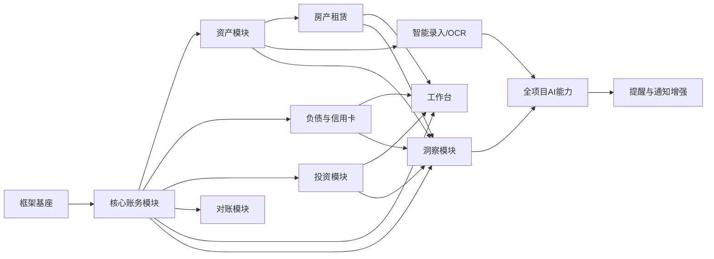

# 18 · 框架基座与模块化交付规范

## 1. 交付策略

项目必须采用“先基座、后模块、逐模块验收”的方式开发。基座完成后，业务模块按依赖顺序一个一个交付；每个模块都必须在不破坏已有模块的情况下完成数据库迁移、API、页面、AI接入、测试和演示。

开发AI不得一开始把所有业务页面做成相互耦合的大页面，也不得为了赶进度把关联字段塞进JSON或临时字段。所有未来关联必须先通过稳定ID、领域接口和只读查询模型预留。

## 2. 框架基座范围

基座只实现可复用能力和最小可运行壳，不实现完整业务模块：

### 2.1 工程基座

全新前后端目录、环境配置、日志、错误处理、健康检查、API版本、数据库迁移、文件存储抽象、测试框架、开发数据初始化和本地启动说明。

### 2.2 系统基座

安装检测、首次启动、数据库连接、管理员创建、登录、刷新会话、退出、密码修改、用户/角色/权限中间件、家庭数据边界、审计、幂等、版本冲突和统一错误码。

### 2.3 前端基座

AppShell、四项一级导航、基于路由的导航选中状态、登录跳转和前进后退同步、路由权限、浅色/深色/跟随系统主题、玻璃质感Token、响应式布局、iPhone 16 393×852px适配、刘海和底部安全区、主题背景、全中文界面字典、组件库、表格、表单、抽屉、统一弹窗、Toast、空/错/加载/无权限状态、全局AI入口占位、通知入口占位。

### 2.4 领域基座

家庭、成员、分类、附件、业务事件、资金变动、审计、统一金额/币种/时间格式、资产主表、关联ID规范、统计查询接口和只读分析接口。

审计基座必须支持请求ID、操作者、对象、关联对象、来源页面、来源方式、字段级前后差异、原因、结果、错误码和耗时；删除和高影响动作在基座统一拦截二次确认所需的确认令牌。

领域基座还必须预留原始金额/币种/汇率字段、数据质量问题接口、备份恢复接口和数据库迁移版本接口。

### 2.5 能力适配器基座

本地AI适配器接口、第三方AI适配器接口、百度OCR适配器接口、通知适配器接口。基座可以提供“未配置/模拟成功/失败降级”状态，但不依赖具体提供商才能启动主应用。

### 2.6 运维基座

开发、测试、生产环境配置分离；部署健康检查；维护模式；备份存储接口；密钥加密接口；附件安全检查；AI评测接口；性能限制和系统状态页面必须在基座中预留。

## 3. 基座完成验收

基座交付必须能完成：

1. 启动系统并判断是否初始化。
2. 配置MySQL并创建管理员。
3. 登录、退出、刷新、修改密码。
4. 创建家庭和成员，验证角色和数据权限。
5. 看到四项一级菜单和玻璃质感应用壳。
6. 从任意一级和二级路由刷新后，选中菜单都与当前路由一致，不能固定第一个菜单。
7. 在 iPhone 16 393×852px 逻辑视口下完成登录、导航、工作台、台账列表、详情弹窗、AI面板和设置表单操作。
8. 打开空的家庭台账、工作台、洞察和设置页面。
9. 使用统一组件展示加载、空、错误、无权限和成功状态。
10. 调用未配置AI/OCR/通知时，页面仍然可用并显示可操作的配置入口。
11. 创建一条最小业务事件草稿并写入审计，不要求此阶段完成完整资产或流水业务。

## 4. 模块交付顺序

交付顺序：

1. 框架基座。
2. 核心账务：分类、账户、统一事件、资金变动、收入、支出、转账和基础统计。
3. 资产：通用资产、不动产、车位、车辆、贵金属、估值和资产事件。
4. 负债与信用卡：房贷、车贷、普通负债、账单、还款和本金/利息拆分。
5. 投资：投资账户、标的、持仓、交易、估值和收益。
6. 房产租赁：租约、应收、实收、押金和逾期。
7. 对账：账户余额核对、差异、调整事件。
8. 智能录入：附件、百度OCR、AI结构化和待确认建议。
9. 工作台：跨模块统计卡片和最近变化。
10. 洞察：跨模块图表、下钻和在线分析。
11. 本地AI与第三方AI：全局助手、页面上下文、工具、建议、外发策略和审计。
12. 提醒与通知增强：提醒中心、PushPlus同步发送、发送记录和重试。

设置、权限、审计、UI组件和错误处理属于基座，不能等业务模块完成后再补。

## 5. 模块交付包

每个模块交付必须包含：

- 模块目标和不包含内容。
- 页面路由和页面状态。
- 数据表和迁移脚本。
- 领域服务和事务边界。
- API契约和错误码。
- 与已有模块的读取/写入关系。
- 关联关系和未来扩展字段。
- AI上下文、AI工具和禁止动作。
- 空、错、加载、权限、冲突和重复提交处理。
- UI玻璃材质、动效和图表交互。
- 单元、接口、页面、权限和回归测试。
- 截图或可访问演示路径。

## 6. 模块边界规则

- 模块只能通过领域服务或公开查询接口访问其他模块，禁止跨模块直接修改对方表。
- 业务事实统一写入业务事件和资金变动；统计统一由统计服务读取。
- 关联关系使用稳定ID和显式关联表；不能把关联对象名称当外键。
- 类型扩展使用独立表，例如 `assets -> real_estates/parking_spaces/vehicles/precious_metals`。
- 业务模块可以先建立关联字段和空状态，但必须在关联模块完成后再启用完整操作。
- AI、OCR和通知只能通过适配器接口接入，业务模块不能直接依赖具体厂商SDK。
- 每个模块可以独立关闭或未配置，但不得导致应用壳崩溃。

## 7. 关联预留基座

统一预留以下关联字段或关联表：

`household_id`、`member_id`、`account_id`、`asset_id`、`real_estate_id`、`parking_space_id`、`vehicle_id`、`liability_id`、`investment_account_id`、`lease_id`、`category_id`、`event_id`、`attachment_id`、`ai_suggestion_id`、`reminder_id`。

如果某模块尚未开发，关联对象显示为“模块未启用/数据不可用”，不能创建假数据，也不能删除关联字段。

## 8. 模块验收门槛

一个模块只有同时满足“数据迁移可重复、API可调用、页面可操作、关联可追溯、AI边界清晰、错误可恢复、回归测试通过”才算交付。只完成页面或只完成表结构都不算模块完成。

## 9. 每次模块交付给用户的内容

开发AI每次只交付一个模块，汇报：模块名称、已完成页面、数据库表、API、关系图、AI能力、测试结果、演示入口、已知限制和下一模块依赖。用户验收通过后再进入下一个模块。

## 10. 未来扩展方式

新增资产类型、新通知厂商、新AI提供商、新OCR服务和新洞察主题，必须通过扩展表、适配器、注册表和版本迁移加入，不能修改已有核心事件含义，也不能增加一级菜单。
